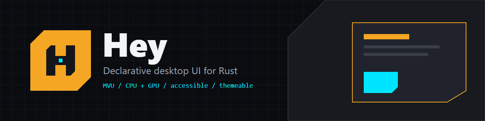

<p align="center">
  
</p>

<p align="center">
  <a href="https://github.com/GLK-Dev/Hey/actions/workflows/ci.yml"></a>
  <a href="https://glk-dev.github.io/Hey/"></a>
  <a href="https://glk-dev.github.io/Hey/wiki/"></a>
  <a href="LICENSE.md"></a>
  
</p>

# Hey

**Hey** is a declarative desktop UI framework for Rust. You describe the interface as a function of your state; Hey handles layout, text, theming, rendering, accessibility and input.

[Website](https://glk-dev.github.io/Hey/) · [Wiki](https://glk-dev.github.io/Hey/wiki/) · [Getting started](Docs/GETTING_STARTED.md) · [Cookbook](Docs/COOKBOOK.md) · [Roadmap](Docs/ROADMAP.md) · [Changelog](CHANGELOG.md)

> **Status:** pre-1.0 (0.x). The API may change between minor versions (see the [API policy](Docs/API_POLICY.md)). The crates are not published to crates.io yet; use a path or git dependency.

## Features

- **Model-View-Update.** One state, one `update`, one `view`. The UI tree is reconciled by key, so widget state survives re-renders.
- **Two interchangeable renderers.** A pixel-exact CPU renderer (the reference) and a GPU renderer (`wgpu`, SDF shapes). Hey falls back to the CPU when no adapter is available; force one with `HEY_RENDERER=cpu|gpu`.
- **Flexbox layout.** Own layout engine: rows, columns, wrapping, gaps, padding, scroll containers with clipping and scrollbars.
- **Real text.** Shaping with `harfrust` (kerning, ligatures, Arabic joining), bidi and RTL, font fallback, ellipsis, wrapping, IME, undo/redo editing.
- **Design tokens and themes.** Light/dark, high contrast and reduced motion follow the OS. Themes can be loaded from files and hot-reloaded.
- **Accessibility.** An AccessKit tree is built from the widgets.
- **Internationalization.** Fluent messages, number and date formatting.
- **HiDPI.** Layout in logical pixels, painting in physical pixels.
- **Testable.** `hey-test` simulates clicks, typing and keys, and compares golden screenshots byte for byte.

**Widgets:** Button, Label, TextInput, TextArea, List, Tabs, Checkbox, Radio, Toggle, Slider, ProgressBar, Panel, Icon; overlays: Dropdown, Menu, Modal, Tooltip.

## Quick start

```rust
use hey_core::{Callback, Insets};
use hey_layout::Style;
use hey_shell::{App, Command};
use hey_style::{Theme, Variant};
use hey_widgets::{Button, Label, View};

#[derive(Clone, Copy, Debug)]
enum Msg {
    Inc,
}

#[derive(Default)]
struct Model {
    n: i64,
}

fn update(m: &mut Model, msg: Msg) -> Command<Msg> {
    match msg {
        Msg::Inc => m.n += 1,
    }
    Command::none()
}

fn view(m: &Model) -> Vec<View<Msg>> {
    let n = m.n;
    vec![View::container(
        "root",
        Style::column().padding(Insets::all(24.0)).gap(16.0),
        vec![
            View::leaf("value", n, move |ui, p| Label::add(ui, p, &format!("Value: {n}"))),
            View::leaf("inc", (), |ui, p| Button::add(ui, p, "+", Variant::Primary, Callback::new(|_| Msg::Inc))),
        ],
    )]
}

fn main() {
    let font = "design/fonts/onest/Onest[wght].ttf";
    App::new(Model::default()).update(update).view(view).theme(Theme::dark()).font(font).title("Counter").run().unwrap();
}
```

Run the bundled examples from a clone:

```sh
cargo run -p counter
cargo run -p todo
cargo run -p gallery
```

The full walkthrough is in [Getting started](Docs/GETTING_STARTED.md).

## Architecture

```text
OS event -> widget -> Msg -> update(&mut Model, Msg) -> view(&Model) -> reconcile -> layout -> paint
```

| Crate | Role |
|---|---|
| `hey-core` | Geometry, colors, ids, arena tree, callbacks |
| `hey-layout` | Flexbox layout |
| `hey-style` | Design tokens, themes, system appearance |
| `hey-text` | Fonts, shaping, bidi, wrapping, text editing |
| `hey-draw` | Display list (`DrawCmd`) |
| `hey-render-cpu` | Reference CPU rasterizer |
| `hey-render-gpu` | `wgpu` renderer |
| `hey-widgets` | Widgets, overlays, `Ui` |
| `hey-shell` | Window, event loop, `App` (winit, softbuffer) |
| `hey-icons`, `hey-i18n` | Icon set; Fluent and formatting |
| `hey-test` | Test harness and golden screenshots |

Design decisions are recorded as [ADRs](Docs/ADR/README.md); see also [Architecture](Docs/ARCHITECTURE.md).

## Performance

Measured on Windows, release build, `examples/counter` (details in the [Roadmap](Docs/ROADMAP.md)):

| Target | Result |
|---|---|
| Input to frame, 1080p, CPU backend | 8.6 ms (typical UI) |
| Cold start to visible window | 137-146 ms warm |
| Idle redraws | none; the event loop waits for input |
| GPU frame, 2000 rects incl. readback | 4.1 ms at 1080p, 14.6 ms at 4K |

Linux and macOS numbers are not measured yet.

## Platforms

Windows is the primary target and the only platform with manual QA so far. Linux and macOS go through winit, but native integration there (macOS menu bar, Linux file dialogs, clipboard) is still planned; macOS is not in CI yet. See the [Roadmap](Docs/ROADMAP.md).

## Contributing

Issues and pull requests are welcome. Run the checks before submitting:

```sh
cargo fmt --all
cargo clippy --workspace --all-targets
cargo test --workspace
```

Golden screenshots are exact byte matches. If a rendering change is intended, regenerate them with `HEY_UPDATE_GOLDEN=1 cargo test` and review the image diffs. Contributor and AI-assistant rules live in [AGENTS.md](AGENTS.md).

## License

Hey is released under the GLK-Dev Universal Innovation License 1.0 (GUIL-1.0). See [LICENSE.md](LICENSE.md).

Created and architected by Vitaly Golik ([GLK-Dev](https://github.com/GLK-Dev)).
